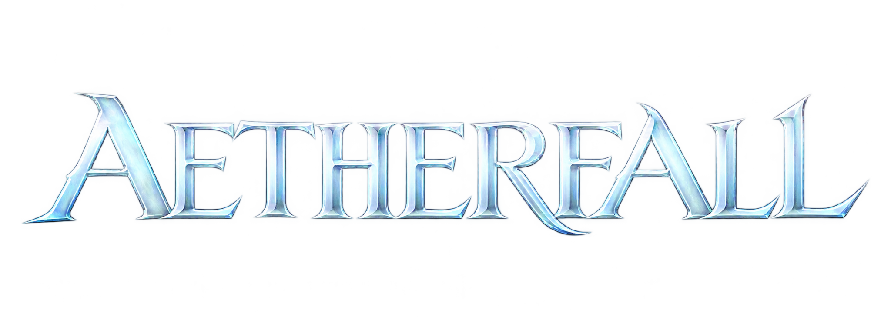

# Aion Aetherfall 4.8 Repack Source

<p align="center">
  
</p>

<p align="center">
  <a href="https://github.com/AngelShade/Aion-Aetherfall-4.8-Repack/releases/latest/download/Aetherfall-Downloader.zip"></a>
  <a href="https://github.com/AngelShade/Aion-Aetherfall-4.8-Repack/releases/tag/v0.94"></a>
  <a href="https://mega.nz/file/hJt0hYTC#fr0RDjsLl4CriZ5dw8MljBhrlP6nD4oYkaErD2iW-vQ"></a>
  <a href="https://drive.google.com/file/d/1kzr5xNIezRPlFHVDQrV1P6B7nNScS_R2/view?usp=sharing"></a>
  <a href="https://discord.com/invite/cpRYCRsSnR"></a>
</p>

**Play Aion 4.8 NA with party companions, shared quests and a world of independent playerbots.**

Aetherfall lets you build a party from your own alternate characters or temporary companions. Take them through quests and dungeons, manage their equipment and combat behavior, and keep your alts caught up with your main. Independent playerbots also quest, fight and visit towns around the world.

**Latest release: [0.94](https://github.com/AngelShade/Aion-Aetherfall-4.8-Repack/releases/tag/v0.94), released 22 October 2026.** It adds Account Fame, new Account and Player Companions windows, more interface options and launcher controls for mods.

The repack includes the game client, servers, Java and MariaDB in one Windows folder. Use the [downloader](https://github.com/AngelShade/Aion-Aetherfall-4.8-Repack/releases/latest/download/Aetherfall-Downloader.zip) to install it, then follow the steps below.

This repository also contains the `4.8` source code. Some newer changes are still in development; the [changelog](CHANGELOG.md) separates them from released updates.

## What's included

Features available in the published repack:

| Feature | What you get |
| --- | --- |
| Party companions | Recruit your own alts or temporary companions. Manage their gear, roles, skills, Stigma builds and party orders in the Player Companions window. |
| Shared quests | Let your owned alts catch up on completed quests and share new completions, including rewards. |
| World playerbots | Independent characters quest, fight, gather, craft and visit towns. Their characters and progress are saved. |
| Account Fame | Build Combat, Life and Legend progress across your account. Earn bonuses, complete Chronicle goals and collect daily Kinah. |
| Dungeon and campaign repairs | Quest, boss, loot and exit fixes, including work on Theobomos Lab and Adma Stronghold. |
| Repeat dungeon entry | Entry limits are disabled by default. Level, quest, party and instance requirements still apply. |
| Central Market & Cash Shop | Buy and sell through the player market, with simulated traders, or browse the in-game Cash Shop. |
| Wardrobe | Customize your character's appearance through the in-game Wardrobe. |
| Season Pass | An in-game progression and reward interface. |
| Starting-area Journey | Begin the story at level 1 or skip to level 10 Daeva Ascension in Poeta or Ishalgen. Available for your main character and companions. |
| Inventory and warehouse | Expanded 288-slot storage with search controls for finding your items. |
| Aetherfall Interface | Move and resize windows, change action-bar layouts and save different HUD profiles. |
| Custom launcher | Choose graphics modes, themes and mods. Run multiple clients using separate accounts. |
| Setup & Server Control Hub | Download, install and update the repack. Start and stop the servers from one window. |
| Optional HD world textures | Use **Mods & tools** in the Hub to download the optional 2x HD pack or switch back to standard textures. |
| Client improvements | Speech bubbles, remembered login, extra graphics options, menu shortcuts and Aetherfall artwork. |

Open **Additional Functions** in the game to find the extra services and companion controls.

### How quest sharing works

Put your owned alts in your party and enable **Party completion sync**. They gradually catch up on quests your main has finished, then share new completions while grouped.

Alts receive the quest's usual rewards, with item choices suited to their class. Rejoining does not award the same completion twice, and repeatable quests keep their normal limits. Quest sharing applies to your owned alts, not other players or independent world bots.

## Download

**Recommended:** download the current Setup below. It installs the full game and lets you apply the latest update. You can pause the download and resume later. If MEGA is unavailable, Setup can try Google Drive.

The full game archive is **36.35 GiB** (about 39 GB). The downloader is about **8.65 MB**, and the `0.94` update is about **639 MB**. The base download is still named `0.86`; use **Update Repack** after installing it to get the latest version. You do not need to install each earlier update.

GitHub's **Code → Download ZIP** downloads source code only. Use one of these options to get the playable repack:

| Download Option | Link | Details |
| --- | --- | --- |
| **Setup (recommended)** | [**Download `Aetherfall-Downloader.zip`**](https://github.com/AngelShade/Aion-Aetherfall-4.8-Repack/releases/latest/download/Aetherfall-Downloader.zip) | Download, install and update from one app. |
| **MEGA** | [**Download `Aetherfall-0.86.7z`**](https://mega.nz/file/hJt0hYTC#fr0RDjsLl4CriZ5dw8MljBhrlP6nD4oYkaErD2iW-vQ) | Full game archive for manual download. |
| **Google Drive** | [**Download `Aetherfall-0.86.7z`**](https://drive.google.com/file/d/1kzr5xNIezRPlFHVDQrV1P6B7nNScS_R2/view?usp=sharing) | Another download location for the same archive. |
| **BitTorrent** | [**Download `Aetherfall-0.86.torrent`**](https://github.com/AngelShade/Aion-Aetherfall-4.8-Repack/releases/download/v0.86/Aetherfall-0.86.torrent) | Download through a torrent client; requires available seeders. |
| **Releases & updates** | [**View releases**](https://github.com/AngelShade/Aion-Aetherfall-4.8-Repack/releases) | Update files, Setup downloads and release notes. |
| **Community Discord** | [**Join the Aetherfall Discord**](https://discord.com/invite/cpRYCRsSnR) | Updates, support, playerbot tips and bug reports. |

<details>
<summary>Archive checksums for manual downloads</summary>

Both mirrors provide the same `Aetherfall-0.86.7z` archive.

- SHA-256: `7b5599837887a49d2b2bebb2ef73f4a9435b42b9686da62aec6354f9954af885`
- Torrent info hash: `ac60eed8cc0438ebd3e8f237fa3cf27700ce740f`

</details>

## Install and play

You need 64-bit Windows, a suitable graphics driver and enough disk space for both the downloaded archive and the extracted game. Java and MariaDB are included. Leave enough memory for the game, servers and Windows to run together.

1. Extract **`Aetherfall-Downloader.zip`** to a folder of your choice and run **`Aetherfall Setup.exe`**.
2. Choose an installation folder and click **Download & Install**. Reopen Setup and choose **Resume** if the download is interrupted. If you already downloaded the archive, choose **Use Local .7z…** instead.
3. On **Install & Update**, click **Update Repack** to install the latest update.
4. Open **Server Control** and click **Start database & servers**. Wait for GameServer to finish loading.
5. Click **PLAY** to open the launcher. Enter a new account name and password in the game to create your first account.
6. When finished, close the game. Use **Stop GameServer**, **Stop LoginServer** and **Stop ChatServer**, then **Stop database** last.

Keep `Client`, `Server` and `Control` together. Close the game and servers before moving the repack folder.

<details>
<summary>Alternative: use the numbered start and stop scripts</summary>

1. Extract the whole package. Keep `Client`, `Server` and `Control` together.
2. Run **`1 - Start Database.cmd`**. The first run sets up the database. Wait for **Database ready**.
3. Run **`2 - Start Servers.cmd`**. Wait for GameServer startup to finish.
4. Run **`3 - Start Client.cmd`**. Enter a new account name and password; LoginServer creates a normal player account on first login.
5. When finished, close the game and all three server components normally, then run **`4 - Stop Database.cmd`**.

</details>

## Update your repack

1. Close the game and stop GameServer, LoginServer and ChatServer. Leave the database running.
2. Open Setup's **Install & Update** tab and click **Update Repack**.
3. Wait for the update to finish, then start the servers again.

Updates keep your accounts, characters, progress and local connection settings. You can update directly from `0.86` or any later version.

If an old Setup cannot update itself, download the current downloader ZIP. Keep your existing settings and Downloads folder to retain saved download progress.

## Settings

Inside the repack, server settings are under `Server/game-server/config`:

| File | Purpose |
| --- | --- |
| `playerbots/playerbots.properties` | Bot numbers and companion settings. |
| `playerbots/features.properties` | Quest automation, crafting, gathering, flight and world activity switches. |
| `playerbots/navigation.properties` | Bot pathfinding and its memory and processing limits. |
| `main/instance.properties` | Instance entry limits and other dungeon settings. |
| `mygs.properties` | Your own settings, which override the other GameServer settings. |

Restart GameServer after changing these settings. Disabling bot automation does not erase saved characters, items or quest progress.

The repack is set up to play on the same computer as the server. Playing from other computers requires changes to the server and client connection settings.

## In development

The `4.8` source has newer work on faction PvP, rift trips, class combat skills, companion movement and spirit following. It also includes camera, quest-dialog and performance fixes.

These changes are not all included in the published `0.94` download. Some still need testing in the game. See the [development changelog](CHANGELOG.md#development-updates--companions-pvp-and-client-repairs-22-october-2026) for details.

## Help and bug reports

Join the [Aetherfall Discord](https://discord.com/invite/cpRYCRsSnR) for support. When reporting a problem, include your repack version, where it happened, what you did and what you expected. Quest names, NPC names, screenshots and relevant log lines help.

Development is ongoing. Some routes, quests and encounters still need work.

## For developers

You only need this section if you want to build or change the server yourself. The ready-to-play download is linked above.

<details>
<summary>Build the 4.8 source on Windows</summary>

| Directory | Contents |
| --- | --- |
| `game-server` | Gameplay code, configuration, quests, encounters and static data. |
| `login-server` | Accounts and login connections. |
| `chat-server` | Chat service. |
| `commons` | Shared server code. |
| `client-mods` | Client modification sources, assets and packaging tools. |
| `tools` | Build and delivery tools. |
| `docs` | Public feature notes and configuration guidance. |
| `third-party/playerbots` | Pinned Playerbots references and license notices. |

Install **JDK 25**, **Maven**, **Python 3** and **Git**, with their commands available on your PATH. From PowerShell:

```powershell
git clone --branch 4.8 --single-branch https://github.com/AngelShade/Aion-Aetherfall-4.8-Repack.git
cd Aion-Aetherfall-4.8-Repack
$env:AION_DEV_ROOT = Join-Path $env:USERPROFILE 'Aetherfall-build'
powershell -NoProfile -File .\tools\build-components.ps1 -Modules 'game-server,login-server,chat-server' -Online
```

This builds all three servers and the shared code. Packages, resources and libraries go into the separate `Aetherfall-build` folder. It does not start servers or change an installation. Maven tests are skipped by default. Client modifications have their own instructions under `client-mods`.

The builder uses `AION_DEV_ROOT` when set, then the local, Git-ignored
`.aion-dev/workspace-root.txt` setting, and otherwise `Aetherfall-build` under your
user folder. An explicit `-OutputRoot` must be inside that external workspace.

Current source builds also provide `playerbots/pvp.properties` for faction fights, pursuit limits and rift trips.

See [Playerbots](docs/PLAYERBOTS.md), [saved bot parties](docs/PLAYERBOTS_SAVED_PARTIES.md) and [class strategies](docs/PLAYERBOTS_CLASS_STRATEGIES.md) for gameplay and configuration details.

</details>

<details>
<summary>Using an older database with a source build</summary>

The 17 October upstream merge changed the server libraries and GameServer schema. Use GameServer, LoginServer, ChatServer and their libraries from the same build. Replacing only the GameServer JAR is not enough.

For an older Aetherfall 076 database, back it up and stop the servers before applying these changes to the GameServer database. Apply each change only if it is missing. Fresh databases created from the updated `game-server/sql/aion_gs.sql` already have them.

```sql
ALTER TABLE players ADD COLUMN pvp_exp bigint NOT NULL DEFAULT '0' AFTER reposte_energy;
ALTER TABLE player_recipes ADD COLUMN production_limit tinyint NOT NULL DEFAULT '0' AFTER recipe_id;
ALTER TABLE player_appearance
  RENAME COLUMN jaw_height TO chin_height,
  RENAME COLUMN chin_jut TO cheek_bones;
```

These changes keep existing rows. The general upstream `update.sql` also contains older changes that may already be installed, so do not run the whole file without checking. Setup patches do not run arbitrary SQL migrations.

</details>

<details>
<summary>Local files and private settings</summary>

The source checkout does not include an installed client, saved player data or local server installations. Keep builds, logs, backups, database contents and private settings out of Git.

Local installations (`target-deploy`), inventories and recovery records are ignored. Store database passwords in each installation's ignored `config/mygs.properties`, `config/myls.properties` or `config/mycs.properties` file. The development database stop helper reads an optional ignored `.aion-dev/mariadb-admin.ini` with a MariaDB `[client]` section, or prompts for a password. Never commit credentials, environment files or private keys.

The repack stores its own database in `Server/database/data` and uses local port `33306`. Its database connection details are in `Server/database/credentials.json`. New repacks start without development accounts, characters or gameplay history.

</details>

## Credits and license

Aetherfall builds on the [Beyond Aion server](https://github.com/beyond-aion/aion-server) and the earlier Aion emulator projects in its history. The repository retains that history and the original contributors' work. Playerbot development also uses the references maintained under `third-party/playerbots`.

The server code is licensed under [GNU GPL v3](LICENSE). Client modifications and third-party components retain their applicable licenses and notices.
