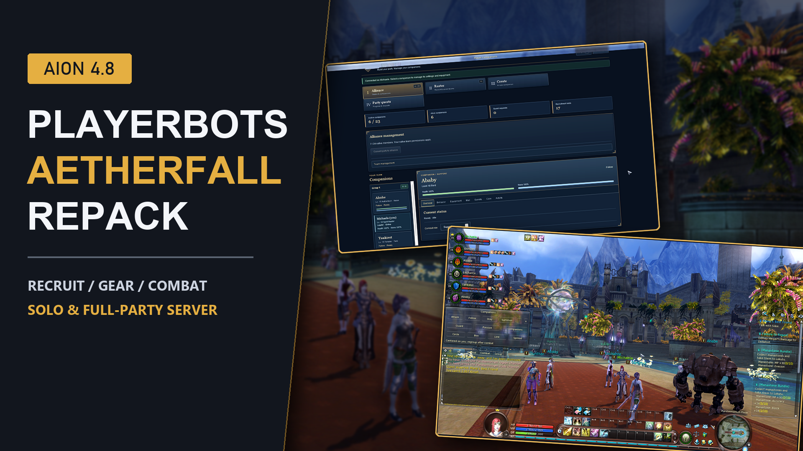
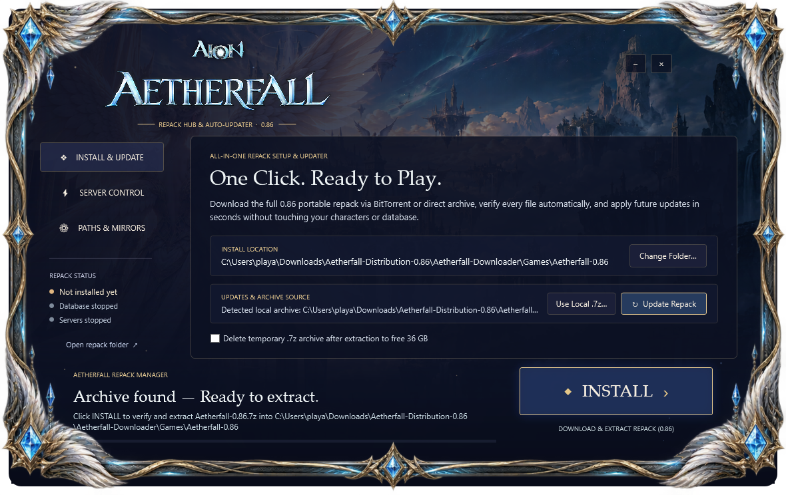
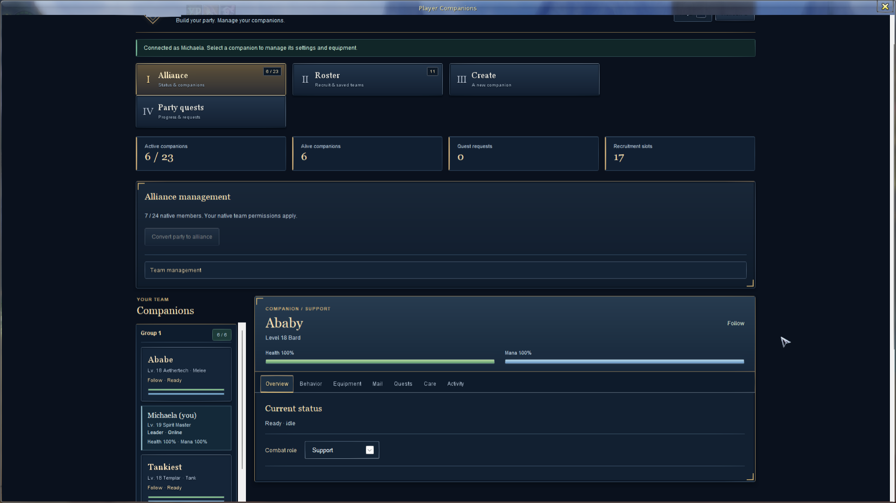
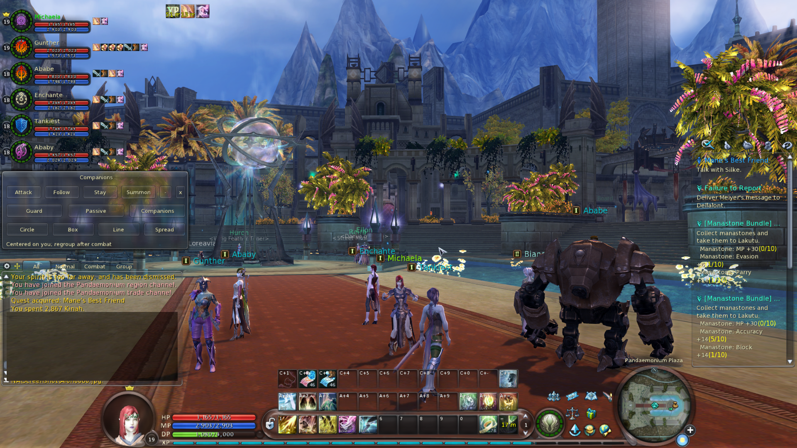
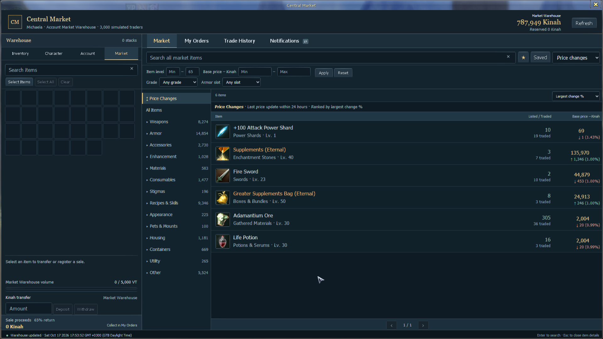

# ⚔️ Aion 4.8 Playerbots — Aetherfall Repack (v0.86)

### **Full Solo & Co-Op Private Server Repack • Autonomous AI Companions • 1-Click Setup & Play**

[-E5AF41?style=for-the-badge&labelColor=12161E)](https://github.com/AngelShade/Aion-Aetherfall-4.8-Repack/releases/latest/download/Aetherfall-Downloader.zip)
[-D9272E?style=for-the-badge&labelColor=12161E)](https://mega.nz/file/hJt0hYTC#fr0RDjsLl4CriZ5dw8MljBhrlP6nD4oYkaErD2iW-vQ)
[-3B82F6?style=for-the-badge&labelColor=12161E)](https://drive.google.com/file/d/1kzr5xNIezRPlFHVDQrV1P6B7nNScS_R2/view?usp=sharing)

 

---

## 💬 Join Beyond emulator Discord thats where my residence is ;)

Have questions, want to share your party screenshots, report bugs, or get notified the moment new updates drop?

👉 **[Click Here to Join the Aetherfall Repack Discord (`https://discord.gg/DAnAjx3tY2`)](https://discord.gg/DAnAjx3tY2)**

---

## 🚀 How to Install & Play (3 Easy Steps — No Technical Setup Required!)

Everything—the **Aion 4.8 NA Aethefall**, **MariaDB Database**, **Java 25 Runtime**, **Game/Login/Chat Servers**, and **64-Bit Vulkan Renderer**—is 100% portable and pre-configured inside this repack. You do **not** need to install Java, MySQL, or edit any config files.

### **Step 1 — Download `Aetherfall-Downloader.zip`**
1. Click **[Download `Aetherfall-Downloader.zip` (7.7 MB)](https://github.com/AngelShade/Aion-Aetherfall-4.8-Repack/releases/latest/download/Aetherfall-Downloader.zip)** (or download it directly from the file list above).
2. Extract the zip anywhere on your PC and double-click **`Aetherfall Setup.exe`**.

  

### **Step 2 — Click "DOWNLOAD & INSTALL REPACK"**
- Inside **`Aetherfall Setup.exe`**, choose where you want the game installed and click **`DOWNLOAD & INSTALL REPACK`**.
- **Built-in High-Speed Google Drive CDN + Torrent:** The installer automatically streams `Aetherfall-0.86.7z` (`36.35 GB`) at full multi-connection speed from Google Drive's CDN (with automatic BitTorrent P2P fallback), verifies the `SHA-256` checksum, and extracts your ready-to-play `Aetherfall-0.86` folder.
- *(Optional Manual Download)*: If you prefer downloading [`Aetherfall-0.86.7z` from Google Drive](https://drive.google.com/file/d/1kzr5xNIezRPlFHVDQrV1P6B7nNScS_R2/view?usp=sharing) in your browser or via [`Aetherfall-0.86.torrent`](Aetherfall-0.86.torrent), simply extract `Aetherfall-0.86.7z` with 7-Zip (`76 GB` extracted).

### **Step 3 — Start Server & Play!**
Using the **Server Control & Play** panel right inside **`Aetherfall Setup.exe`** (or inside your extracted game folder):
1. Click **`1. Start All Services`** — Wait ~30–60 seconds until the status badge turns green (**`ONLINE — READY TO PLAY`**).
2. Click **`2. Launch Aion Aetherfall`** — Opens the custom **Aetherfall Launcher**.
3. Log in with any username & password — **new accounts are created automatically on first login!**
4. When you finish playing, click **`3. Stop All Services`** to save and shut down your server cleanly.

---

## 🔄 1-Click Auto-Updates (Never Re-Download 36 GB!)

When a new version (e.g., `v0.87`) is released:
1. Open **`Aetherfall Setup.exe`** and click **`CHECK & INSTALL UPDATES`**.
2. It automatically downloads only the tiny delta patch (`~10–25 MB`), backs up replaced files, and updates your server and Aethefall in seconds.
3. **100% Safe:** Your database (`Server\database\data`), accounts, characters, gear, and companions are **never** overwritten!

---

## ✨ What's Inside the Aetherfall 4.8 Repack?

### 🤖 1. Full-Party AI Playerbots & Companions
- **Recruit Your Own 6-Man Party or 24-Man Alliance:** Bring your own account alts into your party as AI companions or recruit generated class companions (**Templar, Gladiator, Cleric, Chanter, Sorcerer, Spiritmaster, Assassin, Ranger, Gunslinger, Songweaver, Aethertech**).
- **In-Game Companions Dashboard & Tactical Bar:** Manage equipment, inventory, roles (Tank / Healer / Support / DPS), formations (`Circle`, `Box`, `Line`, `Spread`), and combat stances (`Attack`, `Follow`, `Stay`, `Guard`, `Passive`, `Summon`) with one click.
- **Smart Combat & Navigation:** Proved 3D terrain corridor movement, safe hazard avoidance, cliff/ledge descent, synchronized wing gliding, and smart mana/HP sustain.
- **Interactive Need / Greed / Pass Party Loot:** Real-time 5-slot stacked loot roll panels where companions only roll on items their class can actually use!

  
  

### 🏛️ 2. Living World Economy & Central Market
- **3,000 Simulated Traders:** Dynamic **Central Market** with live supply/demand price fluctuations, buy/sell orders, trade history, and account market warehouse.
- **Integrated In-Game Cash Shop & Wardrobe:** Browse cosmetics, mounts, pets, and consumables directly in-game and unlock appearances in the custom **Wardrobe** interface.
- **Expanded 288-Slot Unified Inventory** with instant search and filtering.

  

### ⚡ 3. Modernized 64-Bit Aethefall & Custom Launcher
- **DXVK (Vulkan) + Direct3D 9 Renderer Switcher:** Smooth high-FPS performance on modern Windows 10/11 GPUs.
- **Seamless Startup Curtain:** Suppresses legacy splash/freeze windows until the 3D login screen is ready.
- **Choose Your Journey (Level 10 Ascension Skip):** Start fresh at Level 1 for the story or skip straight to Level 10 Daeva Ascension in Sanctum/Pandaemonium—available for both your main characters and your companions!

---

## 📦 Release v0.86 Checksums & Verification

| File | Size | SHA-256 Checksum |
| :--- | :--- | :--- |
| **`Aetherfall-0.86.7z`** | `36.35 GiB` (`39,030,688,343` bytes) | `7b5599837887a49d2b2bebb2ef73f4a9435b42b9686da62aec6354f9954af885` |
| **`Aetherfall-0.86.torrent`** | `182 KiB` (`infoHash: ac60eed8...ce740f`) | `4d35d825f8d4e1549970a1c7ecbc33c5d9996b59df602e157fa87fa232bd60be` |

---

### 🌟 Ready to Spread Your Wings?
**[⬇️ Download Aetherfall Setup (`Aetherfall-Downloader.zip`)](https://github.com/AngelShade/Aion-Aetherfall-4.8-Repack/releases/latest/download/Aetherfall-Downloader.zip)** • **[☁️ Google Drive Mirror](https://drive.google.com/file/d/1kzr5xNIezRPlFHVDQrV1P6B7nNScS_R2/view?usp=sharing)** • **[💬 Join the Discord](https://discord.gg/DAnAjx3tY2)**

